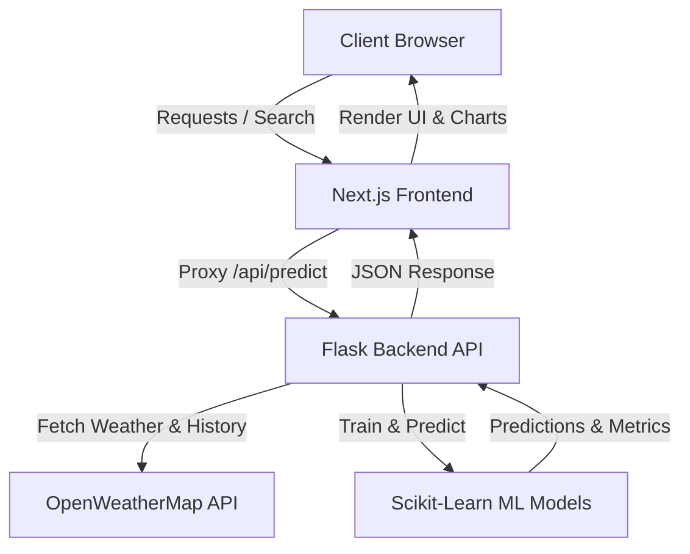

# 🌿 AirQ Predict — Real-Time Air Quality & AQI Forecasting System

[](https://nextjs.org/)
[](https://reactjs.org/)
[](https://python.org/)
[](https://flask.palletsprojects.com/)
[](https://scikit-learn.org/)
[](https://tailwindcss.com/)
[](https://vercel.com)
[](https://render.com)

**AirQ Predict** is a full-stack, machine learning-powered web application that delivers real-time air quality index (AQI) analysis, pollutant level breakdown, and future 7-day predictive forecasting for any city globally.

---

## 🚀 Live Demo & Repository

- **🌐 Live Web App:** [AirQ Predict on Vercel](https://vercel.com/navnit-s-project/aqi-prediction-model)
- **⚙️ Backend API:** `https://aqi-prediction-model-1.onrender.com`
- **💻 GitHub Repo:** [navnit-pandey/AQI-prediction-model](https://github.com/navnit-pandey/AQI-prediction-model)

---

## ✨ Key Features

- 🌍 **Global City Search & Geocoding**: Search for any city worldwide using OpenWeather Geocoding API.
- 🧪 **Comprehensive Pollutant Tracking**: Real-time measurement of **PM2.5, PM10, CO, NO2, SO2, and O3**.
- 📐 **US EPA Standard AQI Calculation**: Precise breakpoint calculation adhering to official US EPA AQI guidelines.
- 🤖 **Multi-Model Machine Learning Ensemble**:
  - **Random Forest Regressor**
  - **Gradient Boosting Regressor**
  - **Extra Trees Regressor**
  - **Ridge Regression**
  - Live model performance evaluation metrics: **R² Score** and **Mean Absolute Error (MAE)**.
- 📈 **7-Day AQI Forecast**: Future air quality trajectory predicted using historical trends and ML regressors.
- 📊 **Interactive Data Visualizations**: Smooth, responsive charts powered by **Chart.js** & modern glassmorphism UI.
- 🛡️ **Health Recommendations**: Tailored health precautions and safety guidance according to AQI severity tiers.

---

## 🏗️ Architecture Overview



---

## 🛠️ Tech Stack

### **Frontend**
- **Framework:** [Next.js 16 (App Router)](https://nextjs.org/) with React 19 & TypeScript
- **Styling:** [Tailwind CSS v4](https://tailwindcss.com/) with Lucide Icons
- **Visualizations:** [Chart.js](https://www.chartjs.org/) & React-Chartjs-2
- **Deployment:** [Vercel](https://vercel.com/)

### **Backend & Machine Learning**
- **API Framework:** [Flask](https://flask.palletsprojects.com/) + Flask-CORS + Gunicorn
- **Machine Learning:** [Scikit-Learn](https://scikit-learn.org/) (Ensemble Regressors, Ridge) & NumPy
- **External Data:** OpenWeatherMap Air Pollution API (Historical & Real-Time)
- **Deployment:** [Render](https://render.com/)

---

## 💻 Local Setup & Installation

### Prerequisites
- **Python 3.10+**
- **Node.js 18+** & `npm`
- **Git**

### 1. Clone the repository
```bash
git clone https://github.com/navnit-pandey/AQI-prediction-model.git
cd AQI-prediction-model
```

### 2. One-Click Launch (Windows)
Simply run the included batch launcher:
```cmd
start-app.bat
```
*This starts both the Flask backend on port `5000` and the Next.js frontend on port `3000`, then automatically opens your browser.*

---

### 3. Manual Launch

#### Backend Setup (Terminal 1)
```powershell
python -m venv .venv
.\.venv\Scripts\Activate.ps1
pip install -r requirements.txt
python app.py
```
*Backend runs on `http://localhost:5000`.*

#### Frontend Setup (Terminal 2)
```powershell
cd frontend
npm install
npm run dev
```
*Frontend runs on `http://localhost:3000`.*

---

## 📡 API Reference

### `POST /api/predict`
Calculates real-time AQI, runs 4 ML regression models on 365 days of historical data, and outputs 7-day future predictions.

**Request Body:**
```json
{
  "city": "Delhi"
}
```

**Response Format (Sample):**
```json
{
  "city": "Delhi",
  "country": "IN",
  "lat": 28.6139,
  "lon": 77.209,
  "current_aqi": 184,
  "category": "Unhealthy",
  "pollutants": {
    "pm2_5": 118.4,
    "pm10": 195.2,
    "co": 1200.0,
    "no2": 45.3,
    "so2": 15.6,
    "o3": 32.1
  },
  "models_evaluation": {
    "Random Forest": { "r2": 0.88, "mae": 12.4 },
    "Gradient Boosting": { "r2": 0.89, "mae": 11.8 },
    "Extra Trees": { "r2": 0.87, "mae": 13.1 },
    "Ridge": { "r2": 0.76, "mae": 18.2 }
  },
  "best_model": "Gradient Boosting",
  "forecast_7_days": [180, 175, 169, 172, 178, 185, 190]
}
```

---

## 👤 Author

**Navnit Pandey**
- GitHub: [@navnit-pandey](https://github.com/navnit-pandey)

---

## 📄 License
This project is open-source and available under the [MIT License](LICENSE).
